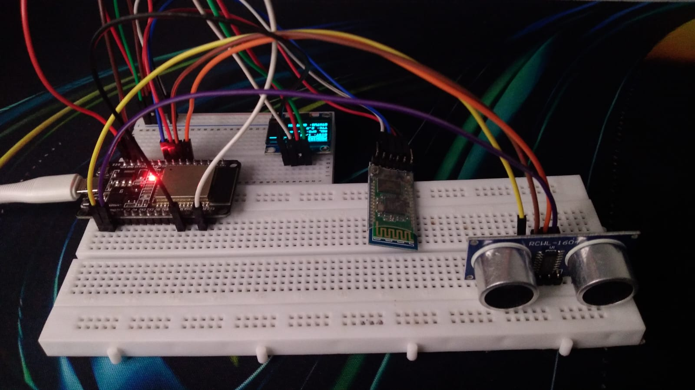
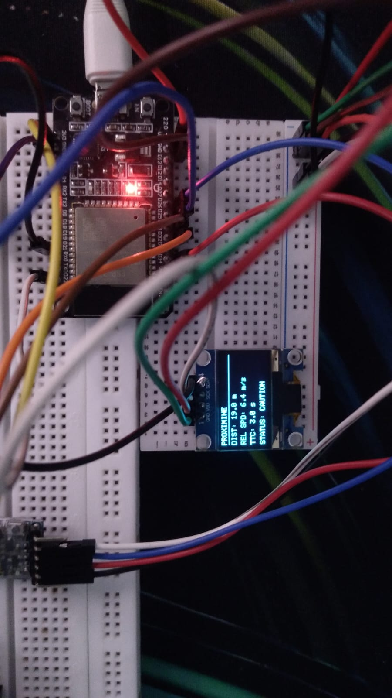
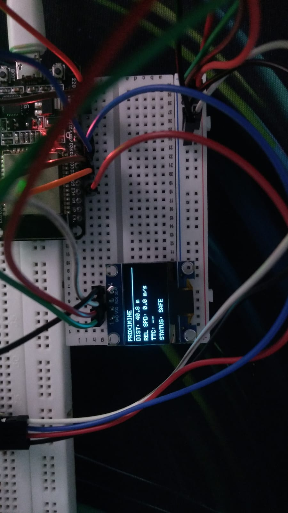
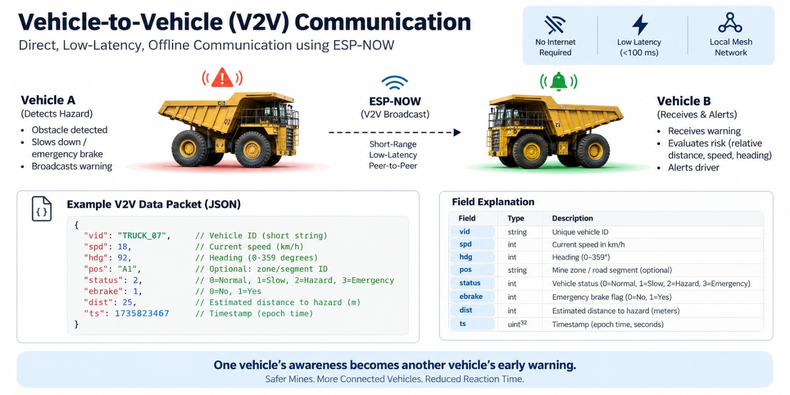

# ProxiMine SafePit

> A low-cost ESP32 "virtual bumper" prototype that measures distance to an obstacle, estimates closing speed and time-to-collision (TTC), and shows a SAFE / CAUTION / DANGER warning on an OLED and LEDs.



Built for **Smart India Hackathon 2026** (Problem Statement **SIH26007**: *Safe and Efficient Operation of Mine Vehicles in Fog and Low-Visibility Conditions in Open Cast Iron Ore Mines*, Hardware track, Team **ProxiMine**).

> **Status:** working bench prototype. It is a student demonstration, **not** a certified mine-safety system and must not be connected to real vehicle brakes or controls.

## Features

- Ultrasonic distance measurement with invalid-reading rejection (2 to 400 cm)
- Exponential moving average filter to smooth the readings
- Closing-speed estimate from successive distance readings, with a small dead-band
- Time-to-collision calculation: `TTC = distance / closing speed`
- Three risk levels based on TTC and an emergency-distance rule
- Live OLED display (distance, relative speed, TTC, status), green / yellow / red LEDs and serial logging

## How it works

```
HC-SR04-type      ESP32 Dev Module                       Outputs
ultrasonic  --->  read -> filter -> closing speed  --->  OLED (I2C)
sensor            -> TTC -> risk level                   Green / Yellow / Red LEDs
                                                         Serial monitor (115200)
```

**Demo scale:** the firmware treats **1 cm measured = 1 m simulated** (`SCALE = 1.0`), so a desk-sized setup can represent truck-scale distances. A reading of `40.8 m` on the OLED is really about 40.8 cm in front of the sensor.

### Risk logic

| Status | LED | Condition |
|--------|-----|-----------|
| SAFE | Green | Not approaching, or TTC > 5 s |
| CAUTION | Yellow | TTC between 2 s and 5 s |
| DANGER | Red | TTC < 2 s, or object within 5 simulated metres |

Thresholds are constants at the top of [`ProxiMine_V2.ino`](firmware/ProxiMine_V2/ProxiMine_V2.ino) (`SAFE_TTC`, `CAUTION_TTC`, `EMERGENCY_DISTANCE`, `FILTER_ALPHA`).

## Hardware

| Component | Role | Qty |
|-----------|------|-----|
| ESP32 Dev Module | Main controller | 1 |
| Ultrasonic sensor (HC-SR04 type; RCWL-1601 module in the photos) | Distance measurement | 1 |
| 0.96" SSD1306 OLED, I2C (128x64) | Status display | 1 |
| LEDs (green, yellow, red) + resistors | Risk indicator | 3 |
| Breadboard + jumper wires, USB cable | Assembly and power | 1 set |

An HC-05 Bluetooth module is also fitted on the breadboard but **is not used by the current firmware**.

### Pinout

| ESP32 Pin | Connected To |
|-----------|--------------|
| GPIO 33 | Ultrasonic TRIG |
| GPIO 32 | Ultrasonic ECHO |
| GPIO 25 | Green LED |
| GPIO 26 | Yellow LED |
| GPIO 27 | Red LED |
| GPIO 21 | OLED SDA |
| GPIO 22 | OLED SCL |
| 3V3 / GND | Sensor, OLED, LED grounds |

OLED I2C address: `0x3C`.

## Getting Started

### Prerequisites

- [Arduino IDE](https://www.arduino.cc/en/software) with the **ESP32 board package** installed
- Libraries (Library Manager): **Adafruit GFX Library** and **Adafruit SSD1306**

### Build and flash

1. Clone the repo: `git clone https://github.com/devnagda69/ProxiMine-SafePit.git`
2. Open `firmware/ProxiMine_V2/ProxiMine_V2.ino` in Arduino IDE
3. Select **Tools > Board > ESP32 Dev Module** and your COM port
4. Click **Upload**, then open the Serial Monitor at **115200 baud**

## Usage

Power the ESP32 over USB. The OLED shows a "PROXIMINE / SYSTEM READY" splash, then live readings. Move an object towards the sensor: the closer and faster it approaches, the sooner the status changes from SAFE to CAUTION to DANGER.

## Results (prototype output)

| CAUTION | SAFE |
|---------|------|
|  |  |
| 19.0 m, 6.4 m/s closing, TTC 3.0 s | 40.8 m, no approach, TTC not applicable |

More photos: [front view](docs/images/hardware-front.jpg), [top view](docs/images/hardware-top-view.jpg), [LED indicators](docs/images/hardware-leds.jpg). Distances and speeds are in demo scale (see above). No formal accuracy or latency measurements have been made yet.

## Known limitations

- The ultrasonic sensor is a low-cost demonstration part, not a mine-grade sensor; readings depend on target shape, angle and temperature
- If no echo is received, the current firmware shows SAFE (green). A sensor timeout should be treated as a fault in a future version
- Closing speed is derived from distance changes only; there is no real vehicle-speed input
- Single sensor, single direction, no data logging to storage

## Future work

- [ ] Treat sensor timeouts and invalid data as an explicit fault state
- [ ] Add a fourth level (WARNING / CRITICAL) with hysteresis to stop status flicker
- [ ] Buzzer alert, and a low-voltage model-vehicle stop demo
- [ ] Use the HC-05 / ESP-NOW for vehicle-to-vehicle alerts (concept below, **not implemented**)
- [ ] Radar or LiDAR for better performance in fog and dust
- [ ] Measured test matrix (false alarms, detection range, alert latency)

### Vehicle-to-vehicle concept (not implemented)



## Documents

- [SIH 2026 presentation](docs/SIH26_ProxiMine_SafePit_Presentation.pptx)

## License

Released under the MIT License. See [LICENSE](LICENSE).

## Author

**Dev Nagda**
[GitHub](https://github.com/devnagda69) | [LinkedIn](https://linkedin.com/in/devnagda39)
